<div align="center">

[](https://github.com/ManojKumarChunduru)
[](https://github.com/ManojKumarChunduru?tab=repositories)
[](https://manojkumarchunduru.github.io/coverage-map.html)


<table align="center">
<tr>
<td align="center"><b>4+</b><br><sub>YEARS ON THE PLATFORM</sub></td>
<td align="center"><b>7</b><br><sub>REPOSITORIES</sub></td>
<td align="center"><b>1783</b><br><sub>TESTS</sub></td>
<td align="center"><b>35</b><br><sub>DECISION RECORDS</sub></td>
<td align="center"><b>3</b><br><sub>CERTIFICATIONS</sub></td>
</tr>
</table>

> I build on one CRM at three successively deeper layers, and I write tools for the questions the platform's own artefacts cannot answer: a deploy that cannot see an agent action's schema drift, a consolidation rate that cannot tell a merge from a split, a coverage percentage that cannot see a governor limit, a record that keeps only its last write, a diff that cannot say which side is stale, a permission set list that cannot enumerate effective access, a review score that cannot tell a better prompt from noise. Each repository names its impossibility in one sentence, leads with the number its author would rather not publish, and re-measures every figure in its own documents before the build goes green.

## The Pivot Point

```
2020 --- Accenture India --- 2022      2023 --- MS, Data Management and Analytics --- 2024 --- PwC USA --- now
         Salesforce Developer                   Washington University of Science and Technology       Salesforce Agentforce Developer
         configuration and Apex                 the data layer, studied on purpose                    Agentforce, Data Cloud, Einstein, Prompt Builder
```

Same CRM, three layers. The first job was configuration and the Apex around it: Flow, Process Builder, Workflow Rules, triggers, the order in which they fire and the ways they collide. The degree was a deliberate move down into the data layer, because every platform problem I had met was a data problem wearing a UI. The current job is data and AI on the platform: Data Cloud streams and identity resolution, Agentforce topics and actions, Prompt Builder templates and the Einstein models behind them. The repositories below follow the same arc from the first row to the last, and the question in each is the same question asked one layer deeper: what does the platform's own artefact fail to tell you, and what would it take to measure it?

## Current Focus

<table>
<tr>
<td width="50%" valign="top">

**At work (PwC USA)**

- Agentforce agents: topics, instructions and custom actions over invocable Apex and Flow
- Data Cloud: streams, the data model, harmonization and identity resolution rulesets
- Prompt Builder templates grounded with record fields, Flow, Apex and retrievers, and the Einstein models behind them
- REST and SOAP integrations with Named Credentials and OAuth 2.0, Platform Events, and the CI around all of it

</td>
<td width="50%" valign="top">

**In the open (this profile)**


- Receipts: every figure in every README, ADR and defense guide re-measured by `make verify` and checked against the prose
- The boundary stated in every repository: which claims the fixture supports and which need a scratch org
- Next: the scratch org experiments each ADR-005 names, in the order the audits ranked them

</td>
</tr>
</table>

## Tech stack, by depth

The yardstick for each level: could I debug this in production at three in the morning (deep), have I shipped it and read its documentation end to end (working), or have I only used it inside something else (shipped with). Evidence is the repository or the resume line that shows it; a badge wall would hide the difference.

| Technology | Depth | Level | Evidence |
| --- | --- | --- | --- |
| Apex (classes, triggers, Batch, Queueable, Future, invocable methods) | `█████████░` | deep | PwC and Accenture work; `apex-bulk-safety-gate` reads the invocable and costing subsets of Apex; every repository ships real Apex beside its tool |
| Flow, Process Builder, Workflow Rules, Flow Orchestration | `█████████░` | deep | `save-order-conflict-tracer` places every write in the documented save order and names the writes lost before commit |
| Salesforce security model: sharing rules, roles, permission sets, profiles | `████████░░` | deep | `sharing-exposure-audit` computes effective access per user from committed metadata and exports, with every path kept |
| Agentforce: Agent Builder, topics, custom actions, GenAiFunction metadata | `████████░░` | deep | PwC work; `agentforce-action-contract-linter` reconciles every action's schema against the Apex or Flow behind it |
| Data Cloud: streams, data model, harmonization, identity resolution | `████████░░` | deep | PwC work; `data-cloud-identity-resolution-audit` replays a ruleset in the Connect API shape over streams with a known truth |
| Prompt Builder, Einstein AI, LLM evaluation, RAG grounding | `███████░░░` | working | PwC work; `prompt-regression-gate` reads GenAiPromptTemplate versions and gates a change on a noise floor and claim-level grounding |
| REST and SOAP callouts, Named Credentials, OAuth 2.0, Platform Events, Change Data Capture | `████████░░` | deep | PwC work; `crm-sync-referee` reads change events offline and refuses to name a stale side when the 72-hour window has closed |
| SOQL and SOSL, LWC and Aura | `████████░░` | deep | PwC and Accenture work |
| SFDX, SF CLI, GitHub, Jenkins, GitHub Actions | `████████░░` | deep | every repository runs as a PR gate on its own fixture with a verify matrix and a gate job that expects a specific exit code |
| Python (standard library tools, pytest, coverage, ruff) | `████████░░` | deep | five repositories, 1357 tests between them, zero runtime dependencies on the default path |
| Node.js and Express.js | `███████░░░` | working | two repositories on ES modules and `node:test` with zero runtime dependencies; Express as a mock external system |
| FastAPI | `██████░░░░` | working | `prompt-regression-gate` serves the gate behind four routes over the same functions as the CLI |
| Streamlit | `█████░░░░░` | shipped with | the audit viewer in `data-cloud-identity-resolution-audit`, an optional extra |
| OpenAI API, Gemini API | `█████░░░░░` | shipped with | optional adapters in `prompt-regression-gate`, never on the default path; no number in that repository comes from them |
| Pinecone, MongoDB, LangChain | `███░░░░░░░` | shipped with | not evidenced by a repository; stated here rather than faked |

## Building Blocks

<div align="center">

**Salesforce platform**


**Data and AI on platform**


**Tooling**


</div>


## Credentials

<div align="center">


MS in Data Management and Analytics, Washington University of Science and Technology (2023 to 2024)

</div>


